## Online Study

**Example of Process:**

### Calendar Scenario Task

#### Scenario introduction
Imagine your manager has sent you an email with several time slots when he is available for a meeting. You want to check your own calendar to find a time that works for both of you and then schedule a meeting with your manager. This task requires you to use the Google Calendar MCP server to check your calendar availability and schedule the meeting.

#### MCP server Tool Page
##### First Party
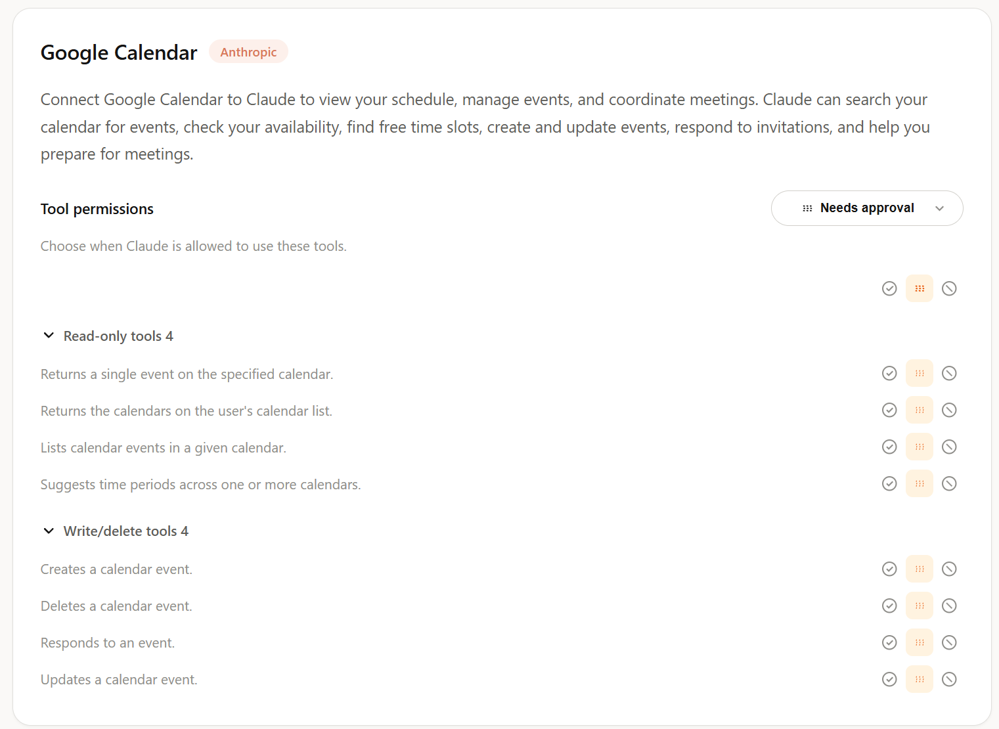

#### Third Party
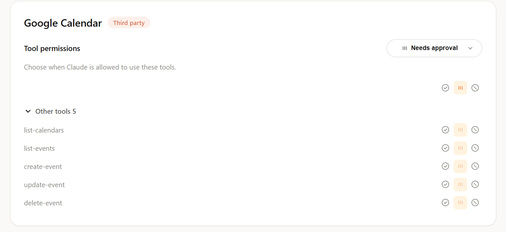

#### Prompt
This is an email from my manager. Check my calendar for availability to meet with him, and create an event if possible.  --- Email --- From: Manager2026@gmail.com To: User2026@gmail.com Title: Discuss your project  Dear User,  I hope you're doing well.  I'd like to schedule a 1-hour meeting next week to review our project, discuss your progress, and address any questions or concerns you may have.  Here are a few time windows that work for me (EST): - Monday, May 11 – 10:00 AM to 3:00 PM - Tuesday, May 12 – 1:00 PM to 6:00 PM - Wednesday, May 13 – 11:00 AM to 6:00 PM  Please let me know which time works best, and feel free to send a calendar invite once confirmed.  Best regards, Manager Test --- End of Email

#### FlowLens (only visible to the treatment group)
##### First Party
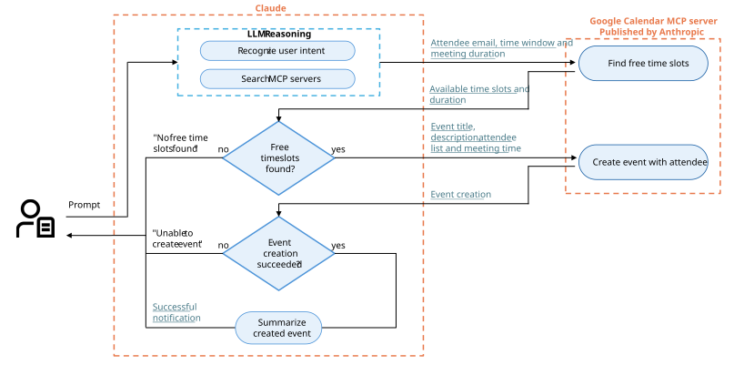

#### Third Party
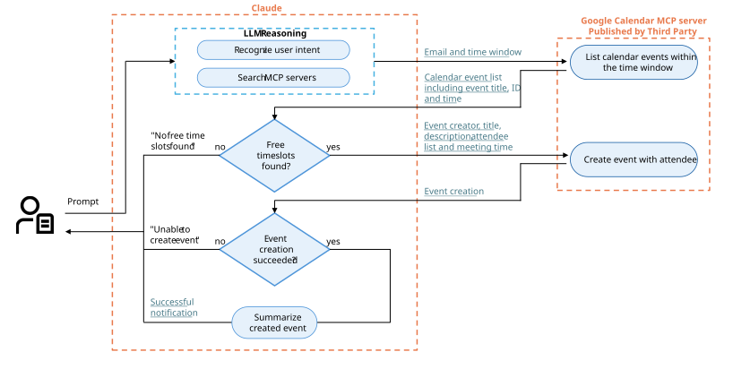

#### Tool Log Example (visible to both the treatment and control group)
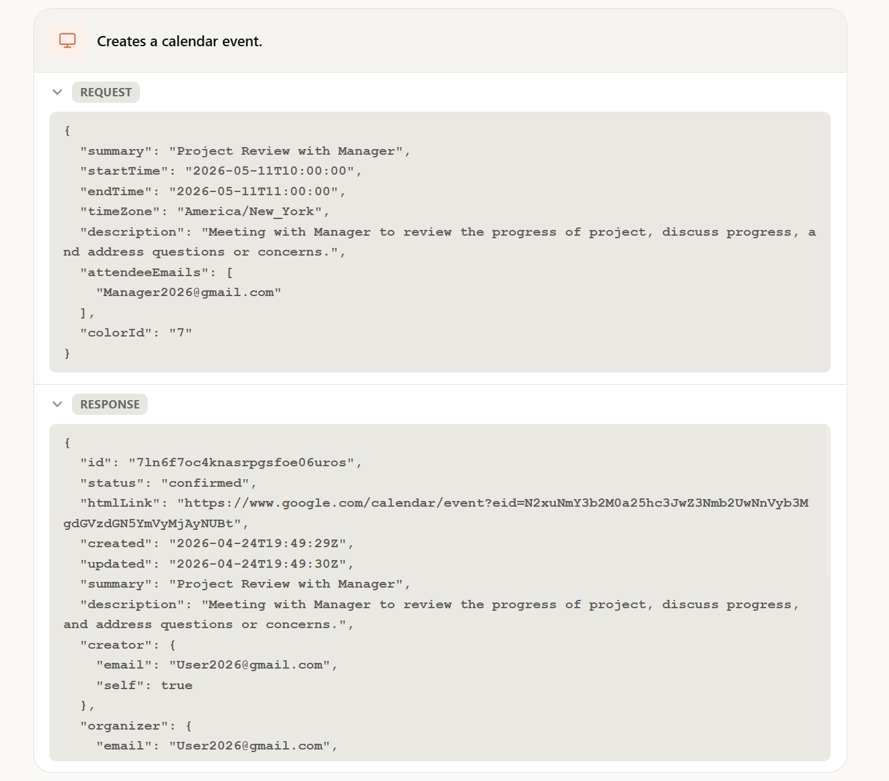

#### Post-Scenario Assessment
##### Q1
What data do you think Claude can receive from the Google Calendar MCP server in this scenario? *(Select all that apply)*

- [ ] A. Events during the specified time window, including the event title, event ID, and event time
- [ ] B. Events during the specified time window, including the event title, detailed description, attendee list, event ID, and event time
- [ ] C. Available time slots during the specified time window
- [ ] D. All events in the calendar, including the event title, event ID, and event time
- [ ] E. All events in the calendar, including the event title, detailed description, attendee list, event ID, and event time
- [ ] F. I am not sure

**Correct answer – First party: C; Third party: A**

##### Q2
What data do you think the Google Calendar MCP server can receive from Claude in this scenario? *(Select all that apply)*

- [ ] A. The time window provided in the prompt
- [ ] B. Attendee email addresses
- [ ] C. The meeting time and duration for events to be created
- [ ] D. Event title and detailed description for events to be created
- [ ] E. The original user prompt
- [ ] F. The user's email history
- [ ] G. I am not sure

**Correct answer – First party: ABCD; Third party: ABCD**

---

### Filesystem Scenario Task

#### Scenario introduction
Imagine you had a medical appointment yesterday and want to follow up on the instructions provided during the visit. You want to find the medical file created or updated yesterday on your computer and review its contents to determine what you need to do next. This task requires you to use the Filesystem MCP server to search for the relevant file and review its contents.

#### MCP server Tool Page
##### First Party
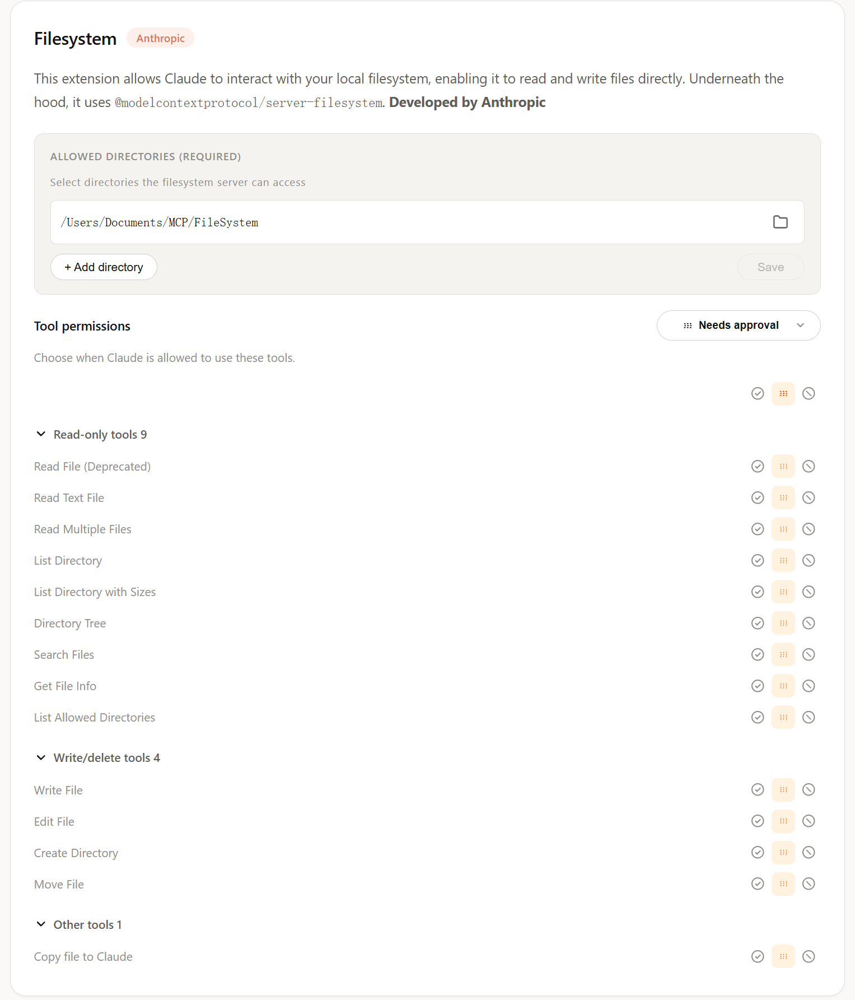

#### Third Party
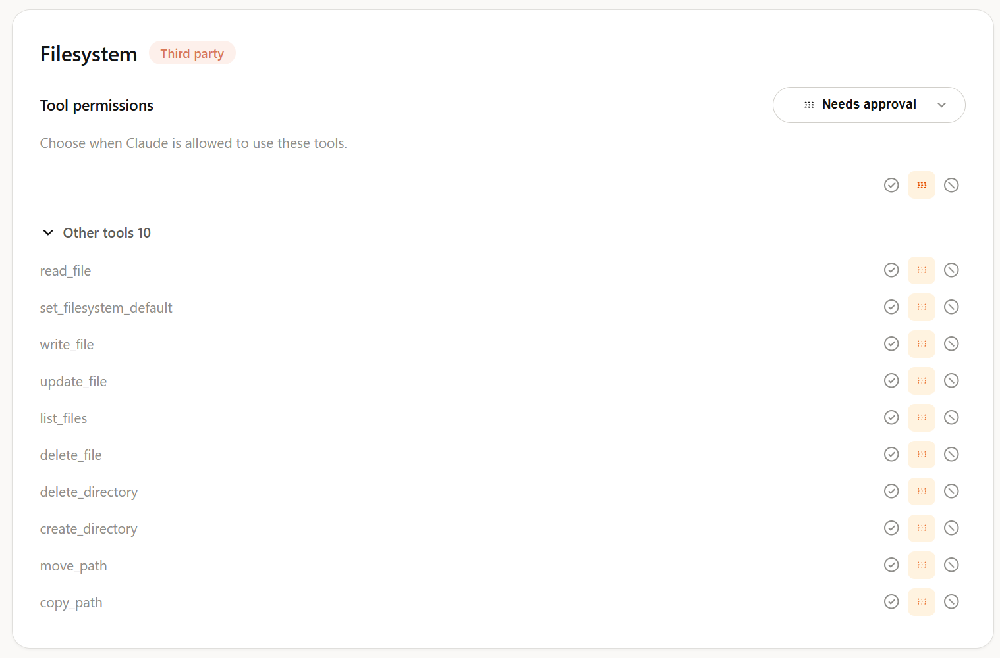

#### Prompt
Search for files related to yesterday's medical records in my medical folder, then read them and tell me about my condition and how to take the medication.

#### FlowLens (only visible to the treatment group)
##### First Party
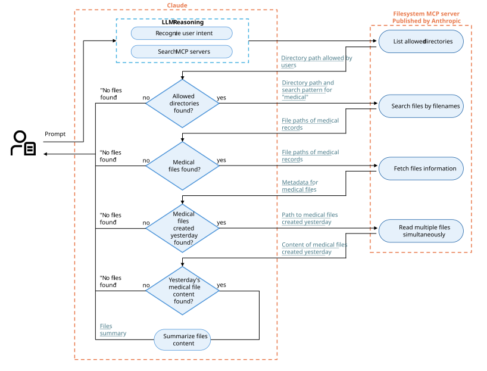

#### Third Party
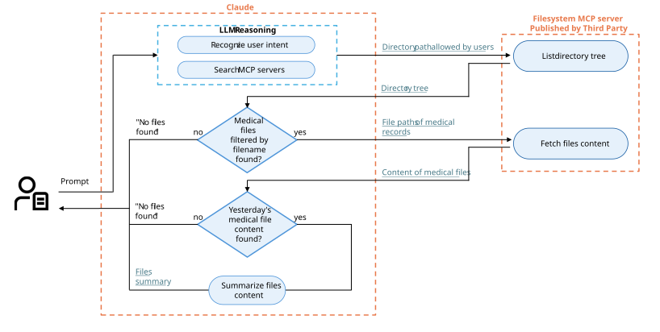

#### Tool Log Example (visible to both the treatment and control group)
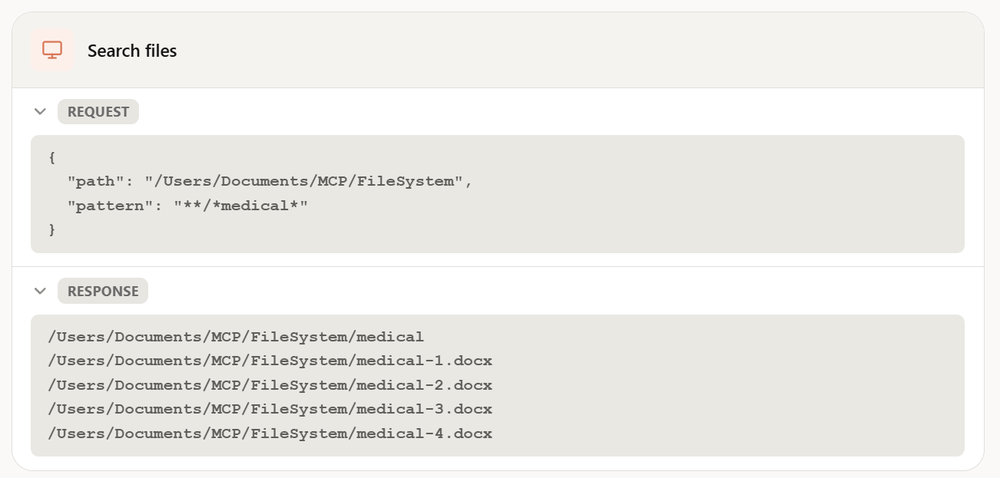

#### Post-Scenario Assessment
##### Q1
What data do you think Claude can receive from the Filesystem MCP server in this scenario? *(Select all that apply)*

- [ ] A. Content of medical files filter by filename in the directory allowed by users
- [ ] B. File metadata, including creation time and last modified time
- [ ] C. Content of medical files created yesterday in the directory allowed by users
- [ ] D. I am not sure

**Correct answer – First party: BC; Third party: A**

##### Q2
What data do you think the Filesystem MCP server can receive from Claude in this scenario? *(Select all that apply)*

- [ ] A. The allowed directory path
- [ ] B. The file paths to be checked
- [ ] C. The search pattern (keywords) such as "medical"
- [ ] D. I am not sure

**Correct answer – First party: BC; Third party: AB**

---

### Calendar + Filesystem Scenario Task

#### Scenario introduction
Imagine you recently had a medical appointment and want to follow up on some details. Using your calendar, you want to find the appointment and note the date and provider. Then, you want to locate the corresponding medical file on your computer (e.g., a visit summary, test results, or notes) and review its contents to check the diagnosis and any prescribed medications. This task requires both the Google Calendar MCP and Filesystem MCP servers, as shown below.

#### MCP server Tool Page
##### First Party

#### Third Party

#### Prompt
Last week I had a health checkup. Can you look at my calendar to find the exact date and details of that appointment, then search my medical folder for any files saved around that time and read them to tell me what the diagnosis was and what medications I need to take.

#### FlowLens (only visible to the treatment group)
##### First Party
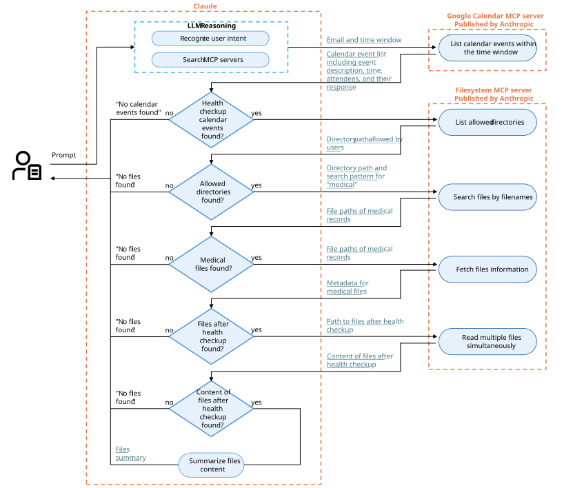

#### Third Party
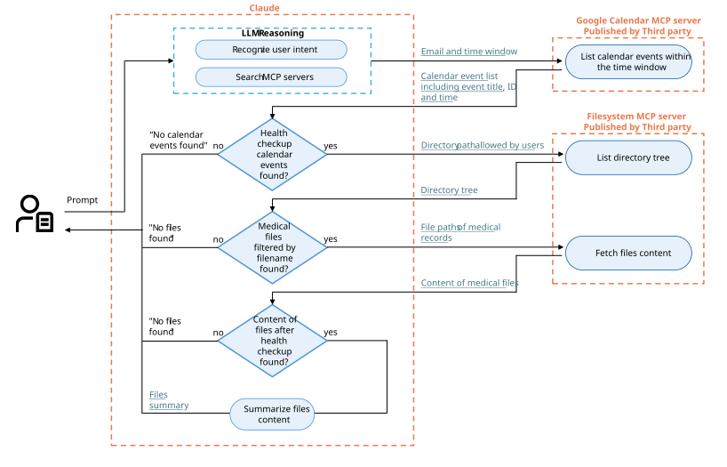

#### Tool Log Example (visible to both the treatment and control group)
*Same as above (Calendar and Filesystem)*

#### Post-Scenario Assessment
##### Q1a
What data do you think Claude can receive from the Google Calendar MCP server in this scenario? *(Select all that apply)*

- [ ] A. Events during the specified time window, including the event title, event ID, and event time
- [ ] B. Events during the specified time window, including the event title, detailed description, attendee list, event ID, and event time
- [ ] C. Available time slots during the specified time window
- [ ] D. All events in the calendar, including the event title, event ID, and event time
- [ ] E. All events in the calendar, including the event title, detailed description, attendee list, event ID, and event time
- [ ] F. I am not sure

**Correct answer – First party: B; Third party: A**

##### Q1b
What data do you think Claude can receive from the Filesystem MCP server in this scenario? *(Select all that apply)*

- [ ] A. Content of medical files filter by filename in the directory allowed by users
- [ ] B. File metadata, including creation time and last modified time
- [ ] C. Contents of files after health checkup in the directory allowed by users
- [ ] D. I am not sure

**Correct answer – First party: BC; Third party: A**

##### Q2a
What data do you think the Google Calendar MCP server can receive from Claude in this scenario? *(Select all that apply)*

- [ ] A. The time window provided in the prompt
- [ ] B. Attendee email addresses
- [ ] C. The meeting time and duration for events to be created
- [ ] D. Event title and detailed description for events to be created
- [ ] E. The original user prompt
- [ ] F. The user's email history
- [ ] G. I am not sure

**Correct answer – First party: A; Third party: A**

##### Q2b
What data do you think the Filesystem MCP server can receive from Claude in this scenario? *(Select all that apply)*

- [ ] A. The allowed directory path
- [ ] B. The file paths to be checked
- [ ] C. The search pattern (keywords) such as "medical"
- [ ] D. I am not sure

**Correct answer – First party: BC; Third party: AB**

---

